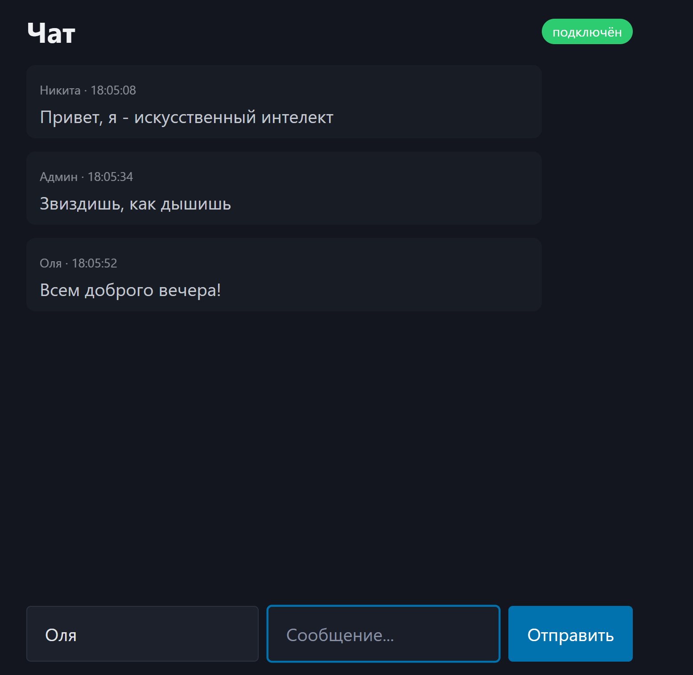

* **Chat_project** - первый учебный проект, сделанный для себя и для опыта.

* Стек: Go, gorilla/websocket
* Для запуска в папке проекта: "go run .". Открывает локальный хост :8081, вводим имя и сообщение
* Тестирование проводилось с помощью браузера и программы Bruno(https://www.usebruno.com/)
* Проект работает на вебсокете /ws, клиент отправляет сообщение вида {"user": "Tom", "text": "привет"} и оно отправляется всем участникам соединения. Лимит сообщений в чате 50, то есть можно свободно увидеть 50 сообщений при обновлении окна чата. При перезапуске сервера история чата стирается
